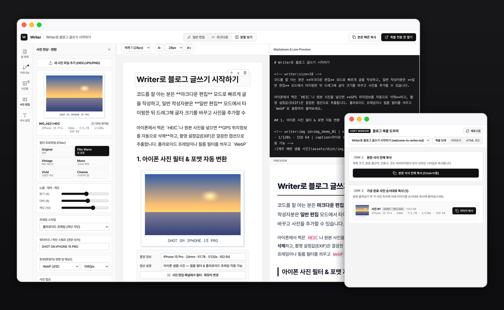
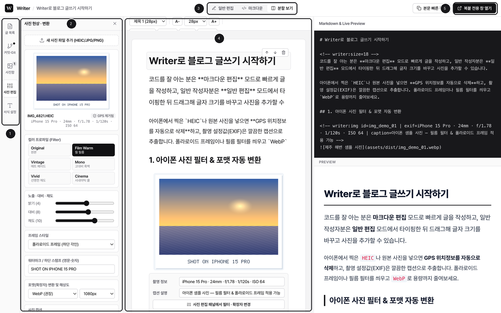
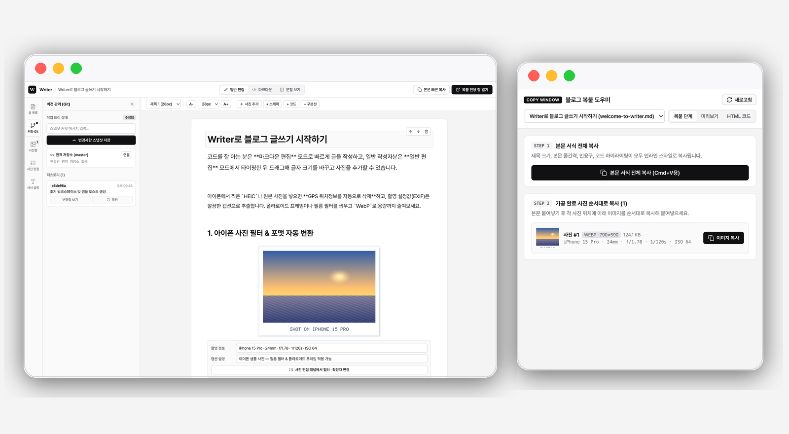

<p align="center">
  
</p>

<h1 align="center">Writer</h1>

<p align="center">
  <b>글쓰기, 아이폰 사진 현상, Git 버전 관리, 그리고 블로그 발행을 하나로 묶은 로컬 데스크톱 에디터</b><br/>
  Built with <b>Rust</b> &amp; <b>Tauri v2</b> for macOS
</p>

<p align="center">
  
  
  
  
</p>

<br/>

<p align="center">
  
</p>

---

## 왜 Writer인가요?

블로그 글을 하나 발행하기 위해 **에디터 따로, 사진 보정 앱 따로, HEIC→WebP 변환기 따로, 티스토리 서식 깨짐 수정 따로** 하던 번거로움을 없애기 위해 설계되었습니다.

* **이중 편집 모드 (일반 편집 ↔ 마크다운)**
  * 마크다운이 익숙하지 않은 분은 **일반 편집 모드**에서 종이 문서에 타이핑하듯 글을 쓰고 글자 크기(`A-` / `A+`)와 문단 스타일을 바꿀 수 있습니다.
  * 코드가 익숙한 분은 **마크다운 편집** 또는 **분할 보기**로 원문을 직접 제어하며, 두 모드는 포맷 손실 없이 실시간 양방향 동기화됩니다.
* **아이폰 사진(HEIC) 현상소 & 프라이버시 보호**
  * 아이폰에서 찍은 `.HEIC`, `.JPG`, `.PNG` 사진을 드래그하면 **민감한 GPS 위치정보 메타데이터를 100% 제거**합니다.
  * 조리개·셔터스피드·초점거리·ISO(`iPhone 15 Pro · 24mm · f/1.78 · 1/120s · ISO 64`)는 자동 추출하여 사진 캡션으로 만들어 줍니다.
  * 필름 컬러 프로파일(`Film Warm`, `Vintage`, `Mono`, `Cinema`), 노출/대비/채도 보정, **폴라로이드 프레임 및 하단 스탬프 각인**, 그리고 **`WebP` / `JPEG` / `PNG` 확장자 변환**을 Rust 네이티브 엔진이 즉시 렌더링합니다.
* **티스토리/외부 블로그 전용 '독립 복붙 윈도우'**
  * 외부 CSS 클래스를 무시하는 티스토리 에디터 특성을 고려해, 모든 타이포그래피·인용구·코드 블록 구문 강조(`syntect`)를 **인라인 CSS(`style="..."`) HTML**로 컴파일합니다.
  * **`[복붙 전용 창 열기]`** 버튼을 누르면 브라우저 옆에 띄워둘 수 있는 **별도의 독립 윈도우**가 열려, **① 본문 서식 복사 → ② 사진 순서대로 원클릭 클립보드 복사**로 발행을 끝낼 수 있습니다.
* **명령어 없는 내장 Git 버전 관리**
  * 실제 변경사항이 있을 때만 스냅샷 커밋이 활성화되며, 언제든 이전 스냅샷과의 변경점(`Diff`)을 비교하거나 원하는 시점으로 안전하게 복원(`Rollback`)할 수 있습니다.

---

## 인터페이스 가이드



| 번호 | 영역 | 설명 |
| :---: | :--- | :--- |
| **1** | **좌측 통합 메뉴바** | **글 목록 · 커밋(Git) · 사진함 · 사진 편집 · 서식 설정**을 아이콘 클릭으로 전환합니다. 활성 아이콘을 다시 누르면 서랍 패널이 접혀 화면 전체를 에디터로 씁니다. |
| **2** | **좌측 작업 서랍 패널** | 선택한 메뉴의 세부 도구가 열립니다. 우측 경계선을 마우스로 드래그해 너비를 자유롭게 조절할 수 있습니다. |
| **3** | **편집 모드 전환** | **일반 편집**(문서형 블록) · **마크다운**(원문 코드) · **분할 보기**(양쪽 동시 비교) 중 원하는 작업 방식을 선택합니다. |
| **4** | **문서 에디터 & 서식 툴바** | 문단 스타일(제목 1~3, 본문, 인용구, 코드)과 글자 크기(`13px`~`32px`), 사진 추가를 상단 고정 툴바에서 바로 조작합니다. |
| **5** | **복붙 전용 창 열기** | 티스토리/블로그로 글과 사진을 옮기기 위한 **독립된 서브 윈도우**를 띄웁니다. |

---

## 복붙 전용 윈도우 & Git 버전 관리



### 1. 티스토리에 글 + 사진 1분 만에 발행하기
1. 메인 창 우측 상단의 **`[복붙 전용 창 열기]`**를 클릭해 서브 윈도우를 티스토리 브라우저 창 옆에 띄웁니다.
2. **`STEP 1: [본문 서식 전체 복사 (Cmd+V용)]`**를 누르고 티스토리 에디터에 `Cmd + V`로 붙여넣습니다. (제목 크기, 줄간격, 인용구, 코드 색상이 그대로 들어갑니다.)
3. **`STEP 2: 가공 완료 사진 순서대로 복사`**에서 각 사진 우측의 **`[이미지 복사]`**를 눌러 티스토리 사진 자리에 순서대로 `Cmd + V` 합니다. (복사한 사진은 자동으로 `복사됨 ✓` 표시로 바뀝니다.)

### 2. 내 블로그 글을 GitHub 원격 저장소에 백업·동기화하기
1. GitHub에서 빈 저장소(예: `my-blog-posts`)를 생성합니다.
2. Writer 좌측 메뉴바에서 **`커밋·Git`** 탭을 열고 **`원격 저장소`** 카드의 **`[연결]`** 버튼을 클릭합니다.
   * **HTTPS 주소**: `https://github.com/내아이디/my-blog-posts.git` *(macOS 키체인/로그인 설정 시 토큰 생략 가능, 필요시 GitHub 토큰 `ghp_...` 입력)*
   * **SSH 주소**: `git@github.com:내아이디/my-blog-posts.git`
3. 글이나 사진 설정을 수정한 뒤 **`[변경사항 스냅샷 저장]`** → **`[Push]`**를 누르면 내 GitHub에 원본 글과 사진 레시피가 그대로 백업됩니다.
   * *(로컬 블로그 데이터는 `~/Documents/WriterWorkspace`에 독립된 Git 저장소로 안전하게 보관됩니다.)*

---

## 설치 및 빌드 방법 (macOS)

### 1. 사전 요구사항
```bash
# Rust 툴체인 설치
curl --proto '=https' --tlsv1.2 -sSf https://sh.rustup.rs | sh

# Node.js 설치 (Homebrew)
brew install node
```

### 2. 클론 및 데스크톱 앱 실행
```bash
git clone https://github.com/iamywl/Writer.git
cd Writer
npm install
npm run desktop
```

### 3. 자동화 검증 테스트 실행 (`writer-core` + `writer-app` E2E)
```bash
npm run test:rust
```
* **검증 항목 (8개 스위트)**:
  1. `VisualBlock ↔ Markdown` 왕복 변환 무결성 테스트
  2. `proptest` 기반 무작위 제목·글자 크기 문단 왕복 동치성 검증
  3. 아이폰 EXIF 촬영 정보 추출 및 가공 후 **GPS 위치정보 0바이트 제거 검증**
  4. macOS 네이티브 `HEIC` 디코딩 및 `WebP` 변환 파이프라인 검증
  5. 티스토리 인라인 CSS 및 `syntect` 구문 강조 HTML 컴파일러 검증
  6. 내장 Git 엔진 스냅샷 커밋 · 빈 스냅샷 차단 · Diff · 롤백 검증
  7. Git 원격 저장소(`origin`) 연결 및 Push 통합 검증
  8. 앱 부트스트랩 → 비주얼 편집 → 사진 레시피 렌더링 → Git 롤백 E2E 검증
